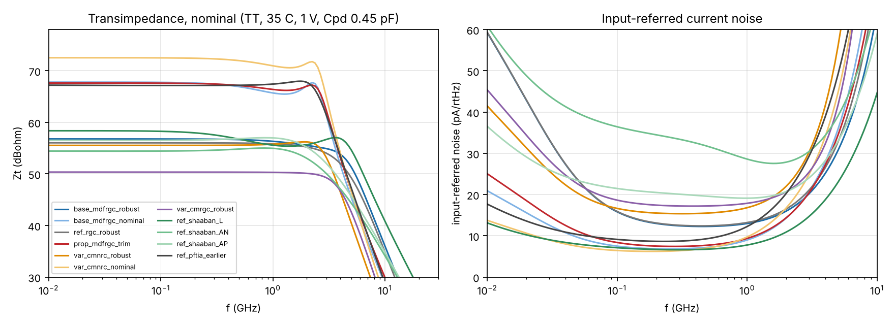
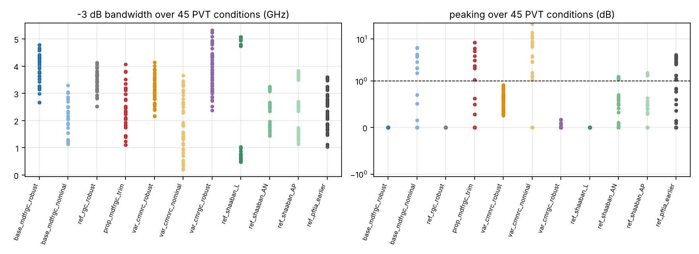
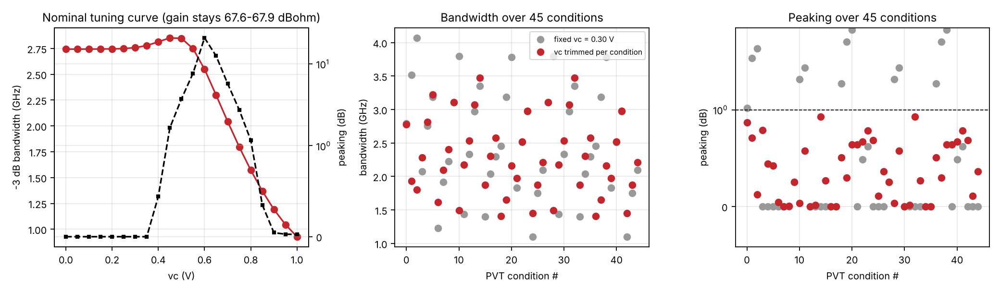

# TIA redesign study (2025 base paper), PTM 90 nm and gpdk090

Everything here is **simulation only**. PTM90 numbers were produced with ngspice 42 and every shipped ngspice netlist
was re-run and matches the optimiser's numbers (`results/netlist_verification.json`). The LTspice, Spectre and Virtuoso
files are generated from the same element lists but **have not been opened in LTspice or Cadence**, and the gpdk090
netlists carry the PTM-sized devices unchanged (see "gpdk090: what you still have to do").

## 1. The short version

* **Base paper (changed):** the Shaaban et al. 2025 full text could not be found anywhere open, so the base paper is now
  **Abdollahi, Mesgari, Saeedi, Sohrabi, Zimmermann, "Low-Noise Modified-RGC TIA With Bandwidth Enhancement Using an
  Intrinsic Negative-RC Network", IEEE Access 13, 33521-33531, 2025** (open access, measured in 0.35 um, 3.3 V).
  Shaaban 2025 stays as related work and as a reconstruction (section 3).
* **Reproduced:** the base paper's circuit was rebuilt from its equations and sized at 1 V in PTM90 under the same rules
  as every other circuit. At equal worst-case sizing it gives **+13 % bandwidth and +24 % gain-bandwidth** over a conventional
  RGC at the same gain (4.01 vs 3.53 GHz at 56.8 vs 56.0 dBΩ). That agrees in direction with the paper's claim. It does not
  validate the paper's numbers, which are for a different process.
* **Proposed (novelty, simulation level):** a **voltage-trimmable negative-RC network**. The degeneration resistor of the
  base paper's second path is shunted by a triode NMOS whose gate voltage `vc` moves the zero/pole pair after fabrication.
  Over 45 PVT conditions at 67.6 dBΩ, the worst peaking is **8.3 dB with `vc` fixed and 0.93 dB with `vc` trimmed per
  condition**, with gain held within 0.2 dB. A fixed design that is safe at every condition without trimming reaches only
  56.8 dBΩ, so the knob buys about **11 dB more gain** (gain-bandwidth 6.6 vs 2.8 THz·Ω).
* **Negative result, reported as such:** my current-mirror variants (the earlier idea of putting the negative-RC path on a
  current mirror) looked best at the nominal corner (72.5 dBΩ) but peak by 22.9 dB at a corner. Sized for worst-case they
  are *worse* than the base paper's own topology (55.5 dBΩ, 3.1 GHz, 1.03 mW vs 56.8 dBΩ, 4.0 GHz, 0.83 mW). I do not
  claim them as the novelty.
* **Honest limits:** trimming does not recover slow corners (bandwidth floor 1.4 GHz), and the control voltage here is
  set by an ideal source: no on-chip generation scheme is designed. There is no layout, no foundry-kit sizing and no silicon.
  See section 7 for what a Q2/Q3 reviewer will ask.

## 2. Rules every circuit was optimised under

1 V supply, 35 C nominal, photodiode capacitance 0.45 pF (the base paper's value), load 50 fF, supply power at most
1.5 mW, peaking at most 1 dB at the nominal corner, every transistor in saturation (Vds above Vdsat by at least 20 mV),
-3 dB bandwidth at least 2.5 GHz, all lengths at least 100 nm for the signal path (the gpdk090 minimum). Objective:
maximise transimpedance × bandwidth. Differential evolution (scipy, seed 1) on log-uniform bounds; scripts in `scripts/`.

* **Nominal-sized** = optimised at TT, 35 C, 1 V only.
* **Worst-case-sized** (`*_robust`) = optimised on the worst of 7 conditions (TT/35/1.0, SS/125/0.9, FF/-40/1.1, FS, SF,
  SS/-40/0.9, FF/125/1.1) with a penalty on bandwidth spread.
* **PVT set used for reporting:** 5 corners × (-40, 35, 125 C) × (0.9, 1.0, 1.1 V) = 45 conditions. **PTM has no foundry
  corners**: corners are emulated as ±30 mV threshold and ±5 % mobility skews (same as the earlier repo work).
* **Monte Carlo:** 200 runs, mismatch only, Pelgrom with **assumed** A_VT = 3.5 mV·µm and A_β = 1 %·µm.
* **Bandwidth** = first -3 dB point below the 10 MHz gain. **Noise** = input-referred current noise, averaged over the
  bandwidth. **Eye:** 3 Gb/s NRZ PRBS7, 20 µA peak-to-peak photocurrent, folded (no clock recovery); the number is the best
  vertical opening over 40 sampling phases.

## 3. The circuits

| File prefix | Circuit | What it is | Status |
|---|---|---|---|
| `base_mdfrgc_*` | Modified dual-feedback RGC with negative-RC network | **Base paper** (Abdollahi 2025) | **Reconstruction from the paper's equations** |
| `ref_rgc_robust` | Conventional RGC | Reference, the circuit the base paper improves on | Standard topology |
| `prop_mdfrgc_trim` | Trimmable negative-RC TIA | **Proposed** | Mine |
| `var_cmnrc_*`, `var_cmrgc_robust` | Current-mirror RGC with / without the negative-RC path | Tested variants, negative result | Mine |
| `ref_shaaban_L / AN / AP` | Current-mirror TIA with shunt feedback and passive / two active peaking inductors | Shaaban 2025 | **Reconstruction from the abstract and figure captions only** |
| `ref_pftia_earlier` | FVF + current mirror + source-follower feedback | Earlier work of this project | Re-sized under the same rules |

**How the base paper was reproduced.** The schematic (their Fig. 3) is an image I could not read, so the netlist comes from
the text: input transistor M1 in common-gate (its source is the input node, its drain the output through R1 to VDD, its gate
the booster node), a booster common-source stage M2 (gate = input, load R2) and a second common-source stage M3 whose gate
is the output and whose source is degenerated by R3 ‖ C3, sharing the booster load R2 at node x. A bias sink Mb sets the
input DC level. This reproduces their transfer function structure, Eq. (4)-(11): A1 = -gm2·R2 with pole 1/(R2·C2),
A2 with the degeneration zero 1/(R3·C3), and an input impedance with a negative-capacitance term proportional to Cin. If
Zimmermann's group drew a detail differently (for example where Mb connects), this is a close cousin, not their netlist.
Please compare against their Fig. 3 before quoting "reproduced" in a paper.

**What is not reproduced.** Zohoori 2018, Alsheikhjader & Issa 2024, Takahashi 2022, Park 2024, Garcia-Montesdeoca 2022 and
Abdollahi 2024: the papers give results but not a node-level schematic in the text I could read (their figures are images),
so I would be guessing. `papers/REFERENCES.md` lists each with what I could verify.

## 4. Results (PTM90, 1 V, 0.45 pF)



| Design | Gain dBΩ | BW GHz | Power mW | Noise pA/√Hz | Gain×BW THz·Ω | Worst peaking, 45 PVT dB | BW range, 45 PVT GHz | MC σ(BW) GHz, samples >1 dB | Eye mV | In-band dip dB |
|---|---|---|---|---|---|---|---|---|---|---|
| `base_mdfrgc_robust` | 56.8 | 4.01 | 0.83 | 18.1 | 2.77 | 0.00 | 2.66 to 4.78 | 0.03, 0/200 | 13.4 of 13.8 | 0.0 |
| `ref_rgc_robust` | 56.0 | 3.53 | 0.80 | 17.3 | 2.23 | 0.00 | 2.52 to 4.12 | 0.01, 0/200 | 12.7 of 13.1 | 0.0 |
| `base_mdfrgc_nominal` | 67.8 | 2.70 | 0.48 | 11.1 | 6.64 | 6.25 | 1.13 to 3.29 | 0.04, 0/200 | 46.0 of 51.9 | 2.3 |
| **`prop_mdfrgc_trim`** | 67.6 | 2.76 | 0.55 | 12.3 | 6.64 | 8.28 (0.93 trimmed) | 1.10 to 4.07 (1.41 to 3.47 trimmed) | 0.46, 0/200 | 48.6 of 52.7 | 1.4 |
| `var_cmnrc_robust` | 55.5 | 3.09 | 1.03 | 20.4 | 1.85 | 0.91 | 2.15 to 4.14 | 0.12, 0/200 | 14.2 of 15.5 | 0.0 |
| `var_cmnrc_nominal` | 72.5 | 2.62 | 0.74 | 12.7 | 11.09 | 22.90 | 0.20 to 3.65 | 0.14, 2/200 | 87.4 of 95.1 | 1.9 |
| `var_cmrgc_robust` | 50.4 | 3.79 | 1.10 | 21.7 | 1.25 | 0.17 | 2.38 to 5.32 | 0.18, 0/200 | 6.7 of 7.6 | 0.0 |
| `ref_shaaban_L` (reconstruction) | 58.4 | 4.74 | 1.49 | 13.4 | 3.93 | 0.00 | 0.48 to 5.08 | 1.85, 0/200 | 12.8 of 16.3 | 3.0 |
| `ref_shaaban_AN` (reconstruction) | 54.4 | 2.55 | 1.24 | 30.1 | 1.34 | 1.27 | 1.44 to 3.24 | 0.06, 0/200 | 11.9 of 12.2 | 0.0 |
| `ref_shaaban_AP` (reconstruction) | 56.5 | 2.54 | 1.23 | 20.3 | 1.70 | 1.58 | 1.14 to 3.83 | 0.06, 0/200 | 15.1 of 15.5 | 0.0 |
| `ref_pftia_earlier` | 67.2 | 2.66 | 0.39 | 15.4 | 6.10 | 4.20 | 1.03 to 3.60 | 0.73, 92/200 | 63.4 of 67.5 | 0.0 |

Read this table with three cautions. (1) Worst-case-sized and nominal-sized designs are different design points: the
worst-case ones give up about 11 dB of gain to be safe at every corner without trimming. (2) The nominal-sized designs have
a 1.4 to 2.3 dB dip between the low-frequency gain and the high-frequency bump, so their "bandwidth" is not a flat band.
(3) `ref_shaaban_*` are my reconstructions sized by my optimiser, not Shaaban's circuits or numbers; their own reported
numbers are 30.6 dB, 2.8 GHz, 1.63 mW, 23.55 pA/√Hz in 45 nm at 1 pF.



### The proposed trimmable network



| `prop_mdfrgc_trim`, 45 conditions | Bandwidth GHz | Worst peaking dB | Gain dBΩ |
|---|---|---|---|
| `vc` fixed at 0.30 V | 1.10 to 4.07 | 8.26 | 67.6 |
| `vc` trimmed per condition (0.05 V grid) | 1.41 to 3.47 | 0.93 | 67.6 to 67.8 |

At the nominal corner `vc` also tunes the bandwidth from 0.93 to 2.85 GHz with gain constant (67.6 to 67.9 dBΩ), but
between about 0.4 and 0.7 V it produces strong peaking (up to 21 dB at 0.6 V): the useful ranges are 0 to 0.4 V and 0.8 to 1 V.
All 45 conditions had a feasible `vc` (peaking at most 1 dB, gain within 1 dB of nominal).

Photodiode-capacitance dependence, all designs: `results/tables.md`. The nominal-sized designs are tuned to 0.45 pF and
drop to about 1.1 GHz at 0.1 pF; the worst-case-sized `base_mdfrgc_robust` holds 3.1 to 4.0 GHz from 0.1 to 1 pF.
Eye diagrams: `results/figures/eye.png`.

## 5. Files

| Folder | Contents |
|---|---|
| `netlists/ngspice/` | `.cir` for every design (run `ngspice -b name.cir`), plus the PRBS file and the AC / noise outputs |
| `netlists/ltspice/` | `.net` netlists, `.asc` schematics with the two MOS symbols, `ptm90.lib`; keep them in one folder |
| `netlists/cadence_ptm/` | Spectre `.scs` with the PTM90 card (runs wherever Spectre runs, no kit needed) |
| `netlists/cadence_gpdk/` | Spectre `.scs` with gpdk090 devices (`nmos1v`/`pmos1v`) and `build_gpdk090_schematics.il` that draws every schematic |
| `results/` | `tables.md`, `figures/`, per-design `char_*.json`, `trim_mdfrgc_t.json`, optimiser outputs in `opt/` |
| `papers/REFERENCES.md` | Base paper, supporting papers, links and how much of each I could read |
| `scripts/` | `circuits.py` (all circuits), `optimize.py`, `analyze.py`, `trim.py`, `build.py`, `emit.py`, `report.py` |

**LTspice:** open a `.net` (File > Open, All files) or the `.asc`, keep `ptm90.lib` beside it, run. One analysis at a time;
the `.tran`, `.noise` and `.step` lines are commented, remove the `;`. The `.asc` nets are joined by label.
`prop_mdfrgc_trim` has a `.step param vcv 0 1 0.05` line for the trimming sweep.
**Cadence, no kit needed:** `spectre name.scs` in `cadence_ptm/`. **Cadence with gpdk090:** next section.

## 6. gpdk090: what you still have to do

The `cadence_gpdk/*.scs` files use the PTM-optimised sizes with gpdk090 devices. I had no gpdk090 kit, so none of it has
been run. The earlier project work already found that PTM sizes are not gpdk090 sizes, so expect a different operating
point.

1. Set the `include` line to your kit path (`.../gpdk090_v4.6/models/spectre/gpdk090.scs`, section `NN`).
2. Run the DC operating point first. Look for the input node near 0.3 V and every transistor in saturation (`dcOpInfo`).
3. Run AC and compare with the PTM numbers above. Expect differences in gain and bandwidth.
4. Re-size in ADE with the Optimizer or by hand, using the same rules as section 2. For `prop_mdfrgc_trim`, then run the
   `swVc` sweep already in the netlist and pick `vc` per corner (NN, SS, FF, FS, SF × -40, 35, 125 C × 0.9, 1.0, 1.1 V).
5. `build_gpdk090_schematics.il`: in the CIW, `load("build_gpdk090_schematics.il")` then `tia25BuildAll("YOUR_LIB")`
   (the library must exist and be attached to gpdk090). It is generated, not executed: if a pin name differs in your kit
   version, edit `tia25Place`.

## 7. Is it publishable? An honest assessment

* **What is not new:** the negative-RC TIA is the base paper's. Bandwidth-tunable TIAs exist (Hwang 2006, Chien 2010; both
  measured). A triode-MOS knob is a standard tuning technique.
* **What may be new:** using the knob on the *degeneration of the negative-RC path* to remove PVT-induced peaking while
  keeping about 11 dB more gain than a fixed worst-case design, at 1 V. I found no prior art doing exactly that, but my search
  was web search, not a Scopus or IEEE Xplore search; please repeat it before submission.
* **What a Q2/Q3 reviewer will ask for:** results with a foundry kit (your gpdk090 corners and Monte Carlo, not emulated
  PTM corners); post-layout extraction; how `vc` is generated on chip (replica or peak detector) and what that costs in
  power and area; noise and linearity (THD) of the trimmed design; a comparison table against measured designs; and an
  answer to the fact that trimming does not fix the slow-corner bandwidth.
* **What would strengthen it most:** the gpdk090 re-sizing and corner study in section 6, a simple on-chip `vc` generator,
  and the Zimmermann group's actual Fig. 3 to confirm the base circuit.

## 8. Reproduce

```bash
pip install numpy scipy matplotlib && apt-get install ngspice     # ngspice 42, scipy 1.x
cd scripts
python3 optimize.py cm_nrc_d1 40 1.5 2.5            # nominal-sized, circuit name, iterations, Pmax mW, Fmin GHz
ROBUST=1 python3 optimize.py mdfrgc 30 1.5 2.5      # worst-case-sized
python3 analyze.py mdfrgc_t                          # PVT, Monte Carlo, Cpd sweep, eye
python3 trim.py                                      # per-condition trimming
python3 build.py && python3 report.py                # netlists, verification, figures, tables
```

Sizes of every design are in its netlist. Search ranges are in `scripts/circuits.py` (`BOUNDS`).
